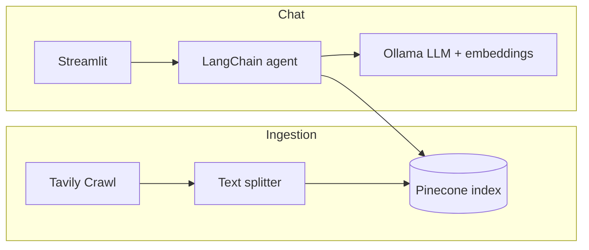

# LangChain Documentation Helper

A retrieval-augmented generation (RAG) assistant for [LangChain Python documentation](https://docs.langchain.com/oss/python/langchain/overview). It crawls docs with Tavily, indexes chunks in Pinecone with local Ollama embeddings, and answers questions through a Streamlit chat UI backed by a LangChain agent.

## Features

- **Ingestion pipeline** (`ingestion.py`): Crawls LangChain docs via Tavily, splits text into chunks, and upserts embeddings into Pinecone.
- **RAG backend** (`backend/core.py`): Ollama chat model with a retrieval tool over the vector index; returns answers plus source URLs.
- **Chat UI** (`main.py`): Streamlit app with message history, loading state, and expandable source citations.

## Architecture



## Prerequisites

| Requirement | Purpose |
|-------------|---------|
| **Python 3.13+** | Project target (see `.python-version`) |
| **[uv](https://docs.astral.sh/uv/)** | Dependency install and lockfile |
| **[Ollama](https://ollama.com/)** | Local models (must be running) |
| **Pinecone** | Vector index for document chunks |
| **Tavily API** | Crawling documentation during ingestion |

Pull the Ollama models used in code:

```bash
ollama pull qwen2.5:7b
ollama pull embeddinggemma:latest
```

Create a Pinecone index whose dimension matches `embeddinggemma:latest` (check [Ollama model card](https://ollama.com/library/embeddinggemma) for embedding size). Use the same index name in ingestion and in `backend/core.py` (see [Configuration](#configuration) below).

## Setup

1. Clone the repository and enter the project directory.

2. Install dependencies:

   ```bash
   uv sync
   ```

3. Create a `.env` file in the project root (`.env` is gitignored):

   ```env
   TAVILY_API_KEY=your_tavily_api_key
   PINECONE_API_KEY=your_pinecone_api_key
   INDEX_NAME=langchain-docs-index
   ```

   LangChain Pinecone integrations typically read `PINECONE_API_KEY` from the environment. Ingestion also requires `INDEX_NAME`.

4. Align the Pinecone index name between ingestion and the chat backend:
   - `ingestion.py` uses `os.environ["INDEX_NAME"]`.
   - `backend/core.py` currently uses the hardcoded name `langchain-docs-index`. Either set `INDEX_NAME=langchain-docs-index` or update `core.py` to use the same env var.

## Usage

### 1. Index documentation (one-time or when docs change)

```bash
uv run python ingestion.py
```

This crawls starting from the LangChain overview URL (with Tavily crawl settings in `ingestion.py`), chunks documents (4000 characters, 200 overlap), and adds them to Pinecone in batches.

### 2. Run the chat app

```bash
uv run streamlit run main.py
```

Ask questions in the UI; the assistant retrieves top matching chunks and cites sources when available.

### 3. Test the backend from the CLI

```bash
uv run python -m backend.core
```

Runs a sample query (`what are deep agents?`) and prints the structured result.

## Project layout

```
documentation-helper/
├── main.py              # Streamlit chat UI
├── ingestion.py         # Tavily crawl → chunk → Pinecone indexing
├── backend/
│   └── core.py          # Agent + retrieval tool + run_llm()
├── logger.py            # Colored console logging for ingestion
├── pyproject.toml       # Dependencies (uv)
├── Tavily Demo Tutorial.ipynb
└── Tavily Crawl Demo Tutorial.ipynb
```

## Configuration notes

- **Crawl scope**: Edit `tavily_crawl.invoke(...)` in `ingestion.py` to change seed URL, depth, or instructions.
- **Retrieval**: `retrieve_context` in `backend/core.py` uses `k=4` similar chunks.
- **Models**: Chat model `qwen2.5:7b` and embeddings `embeddinggemma:latest` are configured in `backend/core.py` and `ingestion.py`.
- **SSL**: Ingestion sets `SSL_CERT_FILE` and `REQUESTS_CA_BUNDLE` via `certifi` for reliable HTTPS.

## Development

Formatting tools are listed in `pyproject.toml` (`black`, `isort`). Run them as needed against your changes.

## License

Apache License 2.0 — see [LICENSE](LICENSE).
